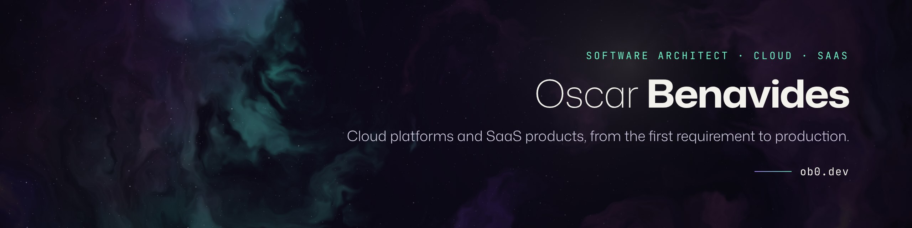

### Hi, I'm Oscar

Software Architect focused on cloud platforms and SaaS products. I lead projects end to end, from the first requirement to production, designing systems that are scalable, secure and built around the people who use them.

#### What I work on

- Cloud architecture for multi-tenant SaaS platforms
- Microservices, APIs and system integrations
- Contact center and omnichannel messaging platforms (Genesys Cloud)
- Analytics and AI on top of customer conversations
- Technical leadership, from discovery to day-to-day operations

#### Toolbox

`Node.js` `Express` `React` `Next.js` `Angular` `.NET` `PostgreSQL` `MySQL` `MongoDB` `Docker` `Linux` `Nginx`

#### About my repositories

Most of my work lives in private repositories for clients and products. Selected, anonymized case studies are on [ob0.dev](https://ob0.dev/#work).

#### Contact

[ob0.dev](https://ob0.dev) · [LinkedIn](https://www.linkedin.com/in/oscarb2408/) · [oscar@ob0.dev](mailto:oscar@ob0.dev)
